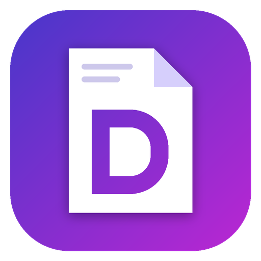

# Docsy
Tiny, fast, native Windows PDF reader. One C++ file, no dependencies, uses the PDF engine built into Windows 10/11. Film-grain textured margins, virtualized thumbnail sidebar (F9) and a footer status bar (page counter, paper size, view modes, zoom) that frame the document pane as one container. Flowing text selection with copy, whole-document Find Text in KillerPDF's floating grain bar (Ctrl+F or the title bar's magnifier button, draggable by its grip), a custom borderless frame, portable single exe.

Keys: Ctrl+O open - drag & drop - wheel scroll (single view flips at the page edges) - Ctrl+wheel zoom - PgUp/PgDn/Space - Home/End - +/- zoom - F or Ctrl+0 fit width - Ctrl+1 100% - Ctrl+2 fit page - F5/F6/F7/F8 continuous/single/two-page/grid views - F9 thumbnails - F11 full screen - Ctrl+F find (Enter/Shift+Enter or F3/Shift+F3 step, Alt+C match case, Alt+W whole word, Esc closes) - drag on text to select, double-click for a word, click the status line for the file size.
